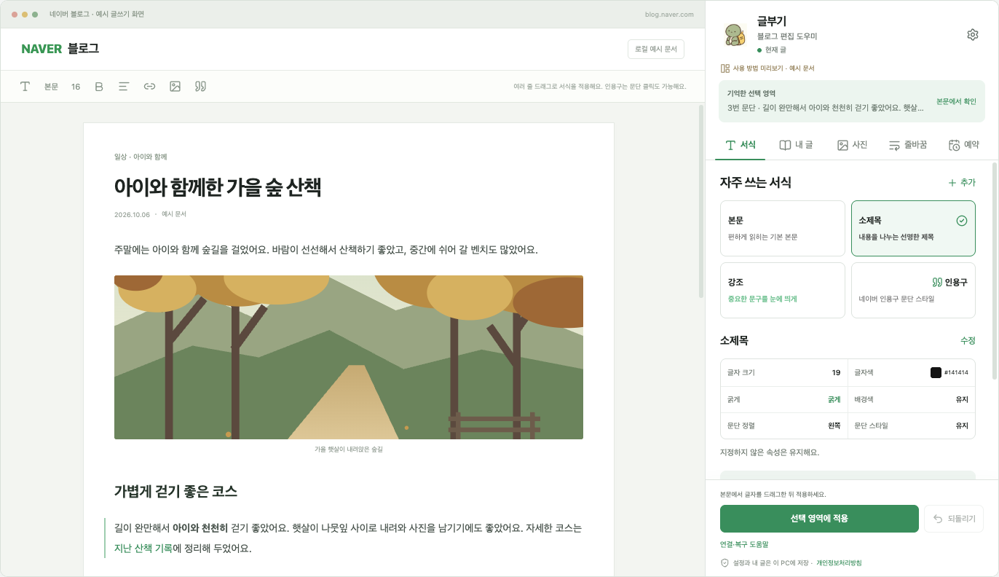

<div align="center">
  
  <h1>글부기</h1>
  <p><strong>글은 내가 쓰고, 편집은 글부기.</strong></p>
  <p>서식부터 줄바꿈, 사진 정리까지.<br>네이버 블로그의 반복 편집을 줄여 주는 Chrome 확장 프로그램입니다.</p>
  <p>
    <a href="https://geulbugi.vercel.app/">소개 사이트</a> ·
    <a href="https://geulbugi.vercel.app/guide/">사용 안내</a> ·
    <a href="https://geulbugi.vercel.app/privacy/">개인정보처리방침</a>
  </p>
</div>



> 제품 화면은 글부기를 직접 실행한 로컬 예시 문서 캡처입니다.

## 글부기는 이런 도구예요

글을 쓰는 시간보다 서식을 맞추고, 사진을 옮기고, 줄을 나누는 시간이 더 길어지곤 합니다. 글부기는 **PC Chrome의 네이버 블로그 글쓰기 화면 옆에 열리는 사이드 패널**에서 이 작업들을 한곳에 모았습니다.

자주 쓰는 서식은 저장해 두고 다시 적용하고, 예전에 쓴 글은 검색해서 링크 카드로 넣으세요. 글의 내용에 집중하면서 반복되는 편집을 간편하게 정리할 수 있습니다.

Chrome 웹 스토어에 **1.0.0**이 공개되어 있으며, 제목 변경과 내 글 링크 연속 삽입 개선을 포함한 **1.0.2** 업데이트를 2026-10-27 심사에 제출했습니다. 현재 검토 대기 중이며 승인 후 자동 게시됩니다. 사용 환경은 **Chrome 116 이상 · 네이버 블로그 PC 글쓰기 화면**입니다.

## 주요 기능

| 기능 | 할 수 있는 일 |
| --- | --- |
| **서식·인용구** | 본문·소제목·강조 서식을 프리셋으로 저장하고 선택 영역에 적용합니다. 네이버 인용구의 여섯 가지 모양도 선택할 수 있습니다. |
| **빠른 단축키** | 최대 8개 슬롯에 서식·인용구 프리셋을 연결해, 지정한 키 조합으로 쉽고 빠르게 적용합니다. |
| **내 글 링크** | 내 블로그 주소를 한 번 설정하면 공개 글을 검색해 네이버 링크 카드로 삽입합니다. 삽입 후에는 카드 뒤에 다음 링크를 이어서 넣을 수 있습니다. 따로 저장한 글도 제목·태그·발췌로 찾습니다. |
| **사진 정리** | 사진과 사진 묶음을 원하는 문단 앞뒤로 옮기고 새 사진을 추가합니다. 현재 글의 사진 AI 활용 설정도 일괄로 켤 수 있습니다. |
| **줄바꿈 미리보기** | 문장·구절을 우선해 줄을 나누고, 변경 전후의 실제 줄바꿈 위치를 비교한 뒤 적용합니다. 길이 우선 방식도 지원합니다. |
| **예약 시간 설정** | 예약 날짜와 시간을 고르고 자주 쓰는 시간을 저장합니다. 최종 발행은 네이버 화면에서 직접 확인하고 실행합니다. |
| **설정 백업** | 프리셋·설정·저장한 글을 JSON으로 내보내고 가져옵니다. |

### 서식과 인용구는 단축키로 더 빠르게

1. 패널에서 자주 쓰는 서식이나 인용구를 프리셋으로 저장합니다.
2. **설정 → 프리셋 단축키**에서 원하는 슬롯에 연결합니다.
3. **크롬에서 키 조합 지정**을 눌러 사용할 단축키를 정합니다.
4. 네이버 본문에서 대상을 선택한 뒤 단축키를 누릅니다.

일반 서식은 적용할 글자를 드래그하고, 인용구는 문단을 클릭하거나 여러 문단을 선택하면 됩니다. 단축키는 사용자가 직접 지정합니다.

## 시작하기

[Chrome 웹 스토어에서 글부기를 설치](https://chromewebstore.google.com/detail/gmcaompgkpccmnpcbngeoabbfkgcoabg)할 수 있습니다. [소개 사이트](https://geulbugi.vercel.app/)에서 기능과 사용 가이드도 확인하세요. 소스에서 직접 설치하려면 아래 순서로 진행하세요.

```sh
npm ci
npm run build
```

1. Chrome 주소창에 `chrome://extensions`를 입력합니다.
2. **개발자 모드**를 켜고 **압축해제된 확장 프로그램을 로드합니다**를 선택합니다.
3. 빌드로 생성된 이 저장소의 `dist` 폴더를 선택합니다.
4. 네이버 블로그 PC 글쓰기 화면을 열고, 확장 프로그램 아이콘을 눌러 글부기 패널을 엽니다.

설치한 확장 프로그램을 사용하는 데 개발 서버는 필요하지 않습니다. 업데이트할 때는 네이버에서 원고를 임시저장한 뒤 확장 프로그램과 글쓰기 탭을 모두 새로고침하세요.

## 내 데이터는 어떻게 다루나요?

프리셋·설정·블로그 주소·저장한 공개 글 자료는 현재 Chrome 프로필의 로컬 저장소에 보관합니다. 본문과 선택 영역은 편집 및 결과 확인을 위해 기기에서 처리하며, **운영자 서버·광고·분석 서비스·AI API로 원고를 전송하지 않습니다.**

내 글 검색, 원문 조회, 링크 카드 생성과 사진 업로드는 해당 기능을 제공하기 위해 네이버와 통신합니다. 설정 백업에는 본문 전체, 쿠키, 비밀번호, 로그인 세션이 포함되지 않습니다. 자세한 내용은 [개인정보처리방침](https://geulbugi.vercel.app/privacy/)에서 확인할 수 있습니다.

## 사용 시 알아두세요

- 네이버 로그인과 PC 글쓰기 화면이 필요합니다. 네이버 편집기 구조가 변경되면 일부 기능이 일시적으로 동작하지 않을 수 있습니다.
- 줄바꿈은 로컬 규칙으로 문장과 구절을 나눕니다. 적용 전 미리보기를 확인하고, 실제 모바일 줄 폭은 네이버 모바일 미리보기에서 확인하세요.
- 직전 편집 작업은 패널의 **되돌리기**로 복원을 요청할 수 있습니다. 작업 후 직접 수정한 내용이 있으면 본문을 확인하고 안내를 따라 주세요.
- 중요한 원고는 네이버에 임시저장하고, 최종 저장·발행은 네이버 화면에서 직접 실행하세요.
- 글부기는 NAVER가 제공하거나 보증하는 공식 서비스가 아닌 독립 확장 프로그램입니다.

## 개발

확장 프로그램은 **TypeScript · React · Chrome Manifest V3**, 소개 사이트는 **HTML · CSS · JavaScript**로 구성되어 있습니다. Node.js는 `^22.13.0` 또는 `24` 이상을 사용합니다.

```text
geulbugi/
├── src/       # 확장 프로그램 소스
├── public/    # manifest, 아이콘 등 확장 리소스
├── tests/     # 자동 테스트
├── scripts/   # 빌드·패키지 검증 도구
├── store/     # Chrome 웹 스토어 소개·제출 자료
├── docs/      # 구현 구조와 검증 기록
└── website/   # 소개 사이트 · Vercel 배포 대상
```

| 작업 | 저장소 루트에서 실행 |
| --- | --- |
| 확장 프로그램 개발 미리보기 | `npm run dev` |
| 타입 검사 / 테스트 | `npm run check` / `npm test` |
| 확장 프로그램 빌드 / 패키지 확인 | `npm run build` / `npm run verify` |
| 전체 검증 및 설치 ZIP 생성 | `npm run release` |
| 소개 사이트 실행 | `npm --prefix website run dev` |
| 소개 사이트 검사 / 빌드 | `npm --prefix website run check` / `npm --prefix website run build` |

소개 사이트는 Vercel에서 **Root Directory: `website` · Build Command: `npm run build` · Output Directory: `dist`**로 배포합니다.

개발 관련 세부 내용은 [구현 구조](docs/구현-구조.md), [통합 검증 절차](docs/통합-검증-절차.md), [사이트 개발·배포 안내](website/README.md)를 참고하세요. 버전별 검증 기록과 작업 이력은 [`docs/`](docs/)에서 확인할 수 있습니다.

## 문의

사용 중 불편한 점이나 제안은 [alstjs1207@naver.com](mailto:alstjs1207@naver.com)으로 보내 주세요.
